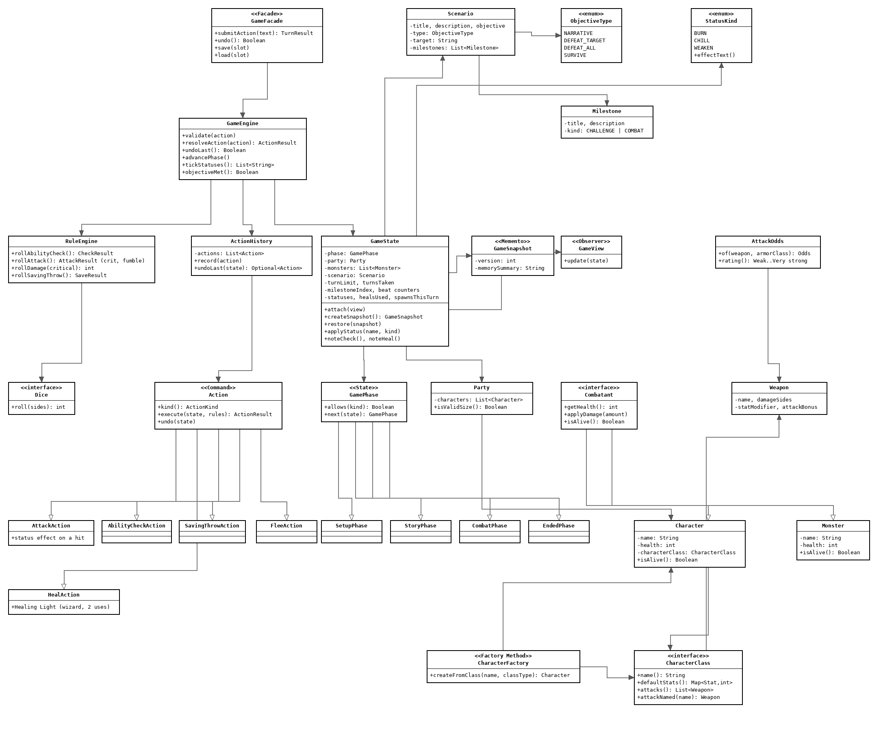
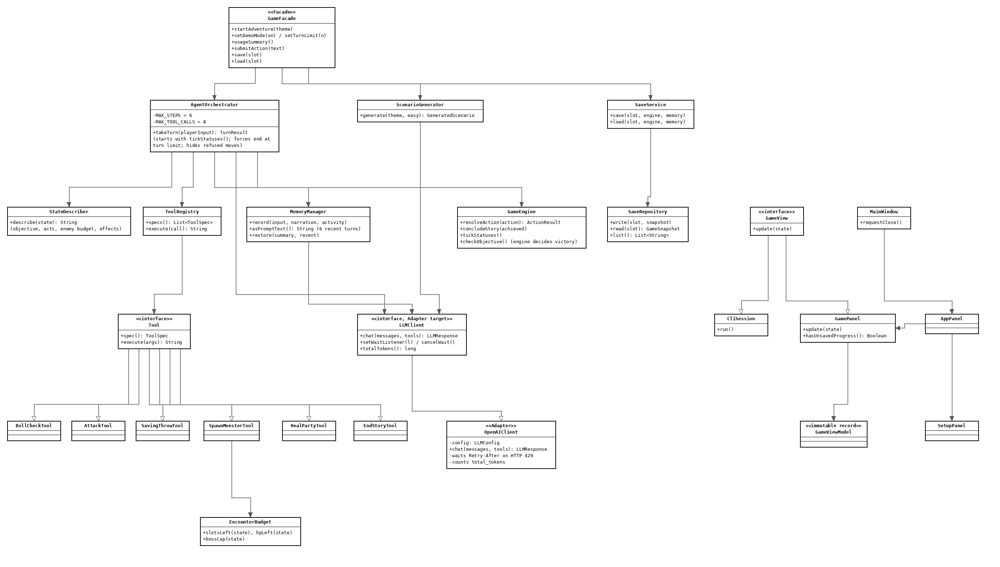
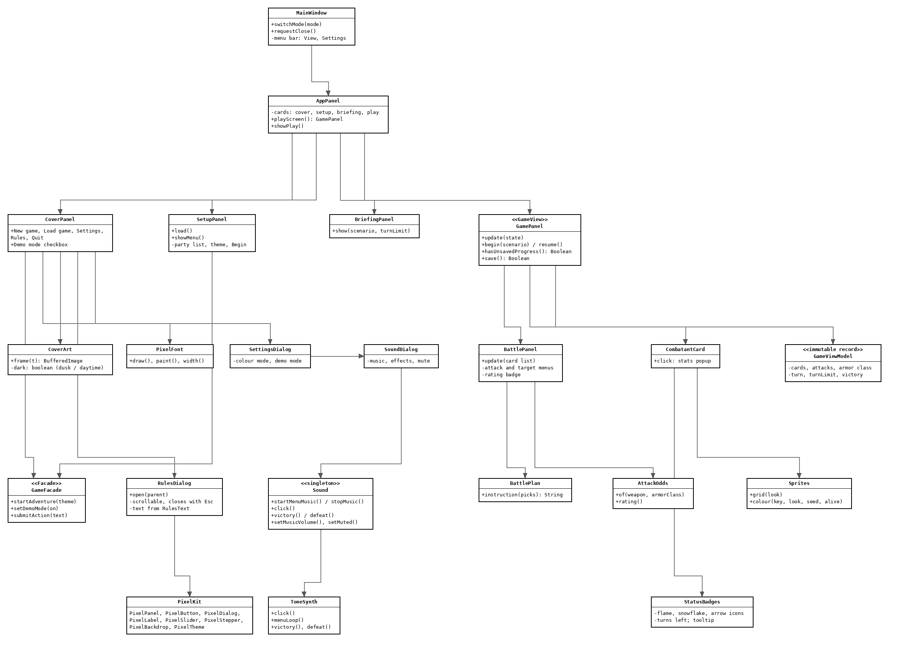
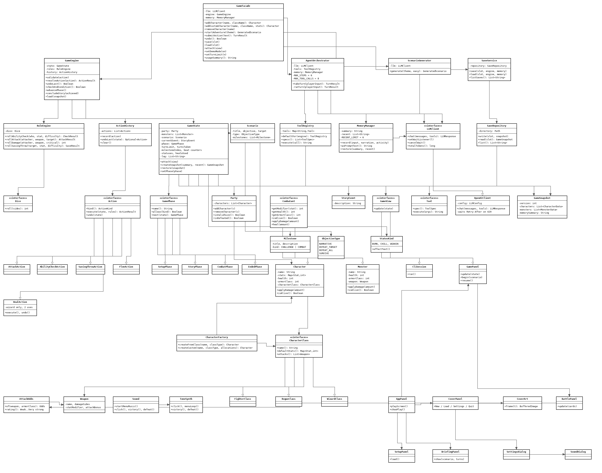
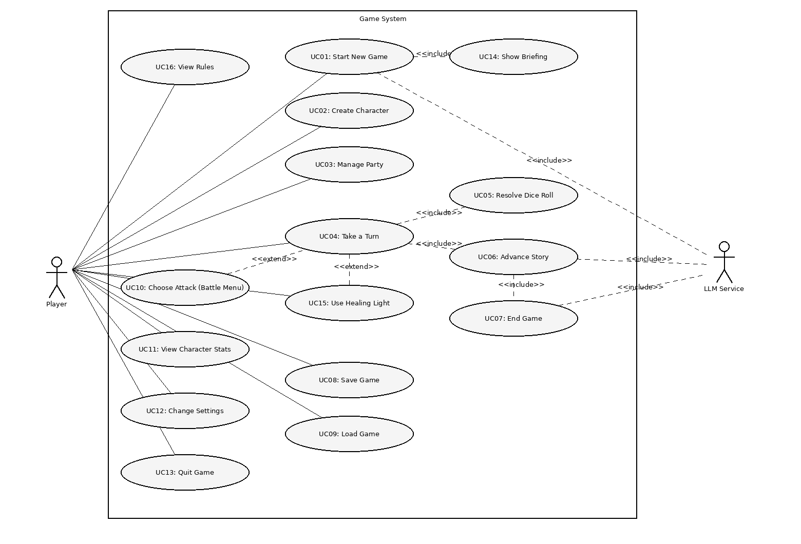
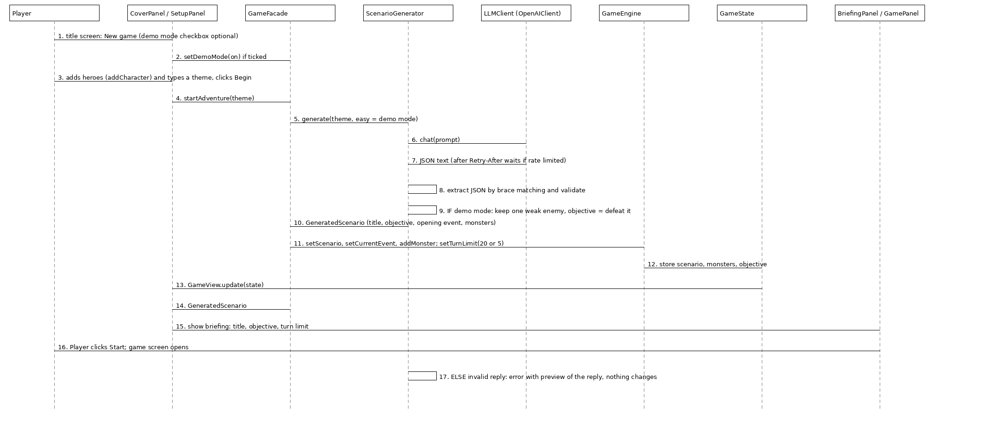
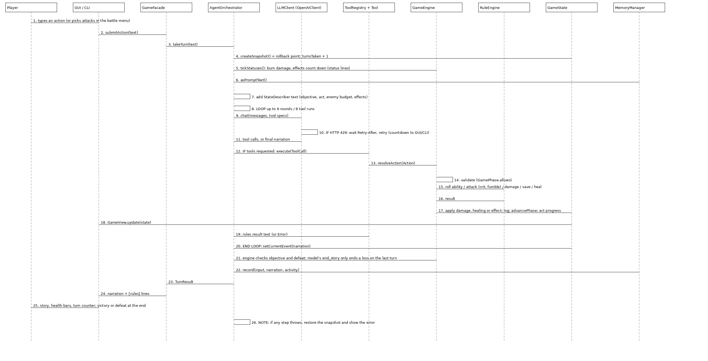

# AI Game Master: UML diagrams (Stage 2)

Full-resolution versions of the diagrams in the Stage 2 report (section 3.3). Click an image to zoom.

## Class diagrams

### Figure 1: domain, rules, state and command classes

### Figure 2: AI agent, tools, memory, persistence

### Figure 3: GUI screens, battle menu, sound and cover classes

### Figure 7: complete class diagram
Concrete tool classes are omitted; see Figures 1 to 3.

## Use-case diagram

### Figure 4: use cases
UC01-UC09 are from Stage 1 (UC01 now includes UC14); UC10-UC16 are new.

## Sequence diagrams

### Figure 5: start a new game (replaces SD01)

### Figure 6: one player turn (replaces SD03)

